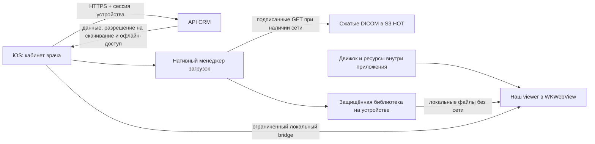

# ORBITAL 3D: ТЗ на iOS-приложение для врачей

Дата: 4 ноября 2026. Редакция 2: обязательный офлайн-просмотр и поэтапные сборки для проверки пользователем. Статус: проект продуктового и технического ТЗ для последующей разработки.

Дополнение от 8 ноября: [контракт сопряжения v1](doctor-mobile-integration-v1-2026-11-08.md) и [OpenAPI](doctor-mobile-v1.openapi.json) уточняют §9 для QR/каталога/скачивания и заменяют общие наброски соответствующих DTO. Новые API ещё не реализованы; web-resolver CRM уже существует. Полное приложение и порядок этапов остаются в силе.

Документ описывает приложение, его дизайн, пользовательские сценарии, мобильный режим нашего viewer и требования к будущим API. В рамках подготовки этого ТЗ сервер, CRM и действующий viewer не изменяются. Разработку backend-интеграции выполнять следующим этапом; до неё приложение работает с явно обозначенным mock-окружением, а viewer проверяется на тестовых обезличенных исследованиях.

Порядок разработки с отдельной собираемой версией после каждого этапа: [Этапы реализации и ручной проверки](doctor-ios-implementation-stages-2026-11-04.md). Выполнять по одному этапу, затем передавать сборку/исходники пользователю для компиляции и проверки. Переходить к следующему этапу после его команды, учитывая замечания к предыдущему.

## 1. Цель и обязательные решения

Создать удобный личный кабинет врача на iPhone: быстро найти пациента, посмотреть его исследования, записать на диагностику, оформить направление и связаться с сотрудниками ORBITAL 3D.

1. Полноценные мобильные экраны, а не уменьшенная копия сайта. Широкие таблицы, недельные сетки и формы рабочего стола перерабатываются под телефон.
2. Лёгкий светлый интерфейс в фирменной фиолетовой гамме. Приоритет — читаемость, свободное пространство и понятные действия.
3. Вход и привязка нового устройства — только через QR из авторизованного кабинета врача. Нет формы входа по логину/паролю, регистрации или входа через соцсети в приложении.
4. В качестве «пароля подключения» в QR предлагается **одноразовый короткоживущий pairing ticket**, а не постоянный пароль CRM. ID врача можно оставить подсказкой; доказательство личности выдаёт сервер по билету.
5. Единственный интерактивный DICOM-просмотрщик — **наш ORBITAL 3D Viewer внутри приложения**. Старый онлайн-просмотр, Ez3D/Guacamole/RDP и выбор стороннего viewer в мобильный продукт не входят.
6. Основной сценарий viewer: **скачать исследование на устройство → открыть его без интернета**, включая после полного закрытия и повторного запуска приложения. Скачиваются только готовые актуальные сжатые серии, стартовый профиль JPEG 2000 20×, при наличии права `online_viewer_enabled` и доступа к конкретному исследованию. Повторное офлайн-открытие проверяет отдельное сохранённое офлайн-разрешение, не требует онлайн-resolver при каждом запуске.
7. Бизнес-данные приложение получает из защищённого API CRM по HTTPS. Нативный менеджер скачивает срезы напрямую из S3 по временным URL в защищённое постоянное хранилище приложения; viewer читает локальную копию. Сам движок, декодеры и ресурсы входят в приложение. Доступа к PostgreSQL, общим ключам S3 или SSH нет.
8. Личная заметка врача, комментарий к записи, сообщение сотрудникам и заключение — разные сущности с разными правами и визуальным оформлением.
9. Не обещать, что настольный viewer уже совместим с iOS. Проверка WKWebView, памяти и касаний на реальных iPhone — первый технический этап, до масштабной разработки оболочки.

## 2. Основание и границы функционала

Инвентаризация выполнена по действующей CRM:

- `C:\Users\Matvey\Documents\Projects\patient_accounting_system\app\blueprints\doctor.py` и `app\templates\doctor\`: главная, пациенты, заказы/исследования, запись, новости, профиль, восстановление снимков.
- `app\blueprints\main.py`, `app\templates\doctor\patient_details.html`: история исследований, панорамы/изображения, PDF и изображения заключения, личные заметки, скачивание, предоставленный доступ, пересылка.
- `app\blueprints\admin\medical.py`, `app\templates\electronic_referral.html`: электронные направления, выбор исследований/зубов, отправка и запись на приём.
- `app\blueprints\chat.py`, `app\templates\doctor_base.html`: чат с сотрудниками, непрочитанные сообщения, реакции, заказ бумажных направлений, уведомления/обращения.

Важные отличия от буквального копирования сайта:

- В `doctor/orders.html` вкладка направлений содержит заглушку, однако отдельный работающий список электронных направлений уже есть. В приложении связать эти сценарии с реальными сущностями, а не переносить заглушку.
- Существующий `app\blueprints\mobile_api.py` предназначен для менеджеров: разрешает роль manager и использует детерминированный токен. Он **не является готовым API авторизации врачей** и не должен автоматически использоваться новым приложением.
- Видимость чужого имени в старом календаре или возможность вызвать старый endpoint не являются основанием расширять доступ врача. Будущий API должен выдавать только разрешённые данные.
- Административные страницы, финансовая отчётность, управление лаборантами/пользователями, служебные операции распаковки и настройки компрессора не входят в приложение врача.
- Основной пользователь первой версии — персональная учётная запись врача. Доступные ему клиники/группы и предоставленные исследования поддерживаются в пределах серверных прав. Полный кабинет организации как отдельная роль — последующий продуктовый этап.

Связанные документы:

- `C:\Users\Matvey\Documents\Projects\Viewers-master\docs\specs\viewer-compressed-hot-contract-v1.md` — действующий формат `_viewer/`, manifest, индексов и точных signed resources.
- `C:\Users\Matvey\Documents\Projects\Viewers-master\docs\specs\crm-new-viewer-gemini-tz-2026-11-04.md` — готовность, права и будущая интеграция CRM с браузерным viewer.
- `C:\Users\Matvey\Documents\Projects\Viewers-master\docs\specs\viewer-hot-compression-plan-2026-11-04.md` — профиль 20×, QR-привязка, ограничения памяти и хранения.
- `C:\Users\Matvey\Documents\Projects\Viewers-master\docs\specs\doctor-ios-implementation-stages-2026-11-04.md` — последовательность этапов, результат сборки и ручная проверка после каждого.

## 3. Платформа и архитектура приложения

Рекомендуемый старт: Swift + SwiftUI, нативная навигация и формы, `URLSession` для API, Keychain для секретов. Ориентир минимальной версии — iOS 17; окончательно подтвердить после проверки viewer и состава устройств врачей. Приложение разрабатывается с приоритетом iPhone; на iPad не должно быть сломанной растянутой формы, полноценный планшетный workspace можно развивать отдельно.

Наш web-движок визуализации используется повторно в `WKWebView` **из ресурсов, поставляемых внутри приложения**, с отдельным мобильным интерфейсом. HTML/JS/CSS, WebAssembly-декодеры, workers, шрифты, логотипы, библиотека нужных инструментов и локальная конфигурация доступны после установки без сети. Начальное открытие viewer не зависит от сайта/VPS/CDN и истёкшей S3-ссылки. Остальной кабинет нативный. Apple предоставляет загрузку локального web-содержимого; совместимость нашего движка с таким режимом нужно подтвердить ранней сборкой. [Apple loadFileURL](https://developer.apple.com/documentation/webkit/wkwebview/loadfileurl(_:allowingreadaccessto:)). Не считать этот конкретный API окончательным решением для WASM/workers/изоляции до теста; допустим иной проверенный публичный локальный адаптер.

Разделение модулей:

- AppShell: навигация, дизайн-система, состояние подключения, локальная блокировка.
- Pairing/Auth: QR, проверка сервера, сессия устройства, обновление/отзыв доступа.
- Home, Patients/Studies, Booking, Referrals, Messages, News, Restoration, Profile.
- ViewerHost: WKWebView, доверенный bridge, жизненный цикл и события загрузки.
- Downloads/StudyLibrary: очередь скачивания, проверка состава, защищённое хранение, локальный индекс, офлайн-разрешения и рабочие проекты.
- API/Repositories: единые модели и протоколы; отдельные Mock и Remote реализации.
- SecureStorage, Privacy, Files, Push, Diagnostics: системные интеграции без смешивания с бизнес-экранами.

Схема взаимодействия:



Прямые запросы приложения к API CRM — целевая архитектура онлайн-функций. Отдельный промежуточный сервер только ради «спрятать адрес CRM» не требуется. Защиту обеспечивают проверка сессии, ACL, TLS и отзыв устройств. Нативные запросы не используют браузерные cookie/SameSite/CORS; локальный web-модуль работает в ограниченном доверенном контексте. Обновление автономного движка поставляется совместимой сборкой приложения; непредсказуемое скачивание нового web-кода при открытии не является условием работы.

## 4. Вход только через QR

### 4.1. Пользовательский сценарий

1. Первый экран: логотип, короткое объяснение «Ваш кабинет и исследования — под рукой», основная кнопка «Сканировать QR» и помощь «Где найти QR?».
2. Помощь: «Откройте личный кабинет врача на компьютере → Подключить приложение → отсканируйте код». Это будущий элемент веб-кабинета.
3. Разрешение камеры запрашивать при нажатии кнопки, не при первом запуске без объяснения.
4. Сканер содержит рамку, подсказку, закрытие и фонарик. Разрешить сканирование камерой; импорт QR из фото в первую версию не включать по умолчанию.
5. После проверки кода показывать **подтверждённые сервером** имя врача, организацию и домен, затем действие «Подключить». Не считать произвольное имя/ID внутри QR подтверждённой личностью.
6. Сервер обменивает билет на отдельную сессию устройства. Рекомендуемое усиление для будущего backend: подтверждение нового устройства в открытом веб-кабинете, без ввода пароля в iPhone.
7. После успешного подключения открыть главную. При следующем запуске использовать сессию устройства; заново сканировать QR каждый день не требуется.
8. Face ID/Touch ID/системный код устройства могут локально разблокировать сохранённую сессию. Это не другой способ первоначального входа и не замена серверной авторизации.
9. При выходе или полученном подтверждении отзыва — снова экран QR. Потеря сети или окончание короткого access token сами по себе не уничтожают действующее офлайн-разрешение. При недоступной сети после локальной разблокировки разрешён раздел скачанного; онлайн-функции требуют восстановления серверной сессии. При истёкшем офлайн-разрешении — обновление доступа онлайн/перепривязка по ситуации. «Переподключить по QR» находится в настройках; одновременно активно одно подключение.

### 4.2. Формат QR — проект будущего контракта

```json
{
  "type": "orbital.doctor.pairing",
  "version": 1,
  "server": "https://admin.orbital3d.ru",
  "doctor_id": "<подсказка ID врача, не средство авторизации>",
  "pairing_ticket": "<случайный одноразовый секрет>",
  "expires_at": "<UTC timestamp>"
}
```

Это проект схемы, а не уже существующий endpoint. Вместо постоянного пароля используется одноразовый билет, предлагаемый TTL — 2 минуты. Истечение и однократность подтверждает сервер; полю времени в QR недостаточно доверять. Билет атомарно расходуется при успешном завершении привязки; повтор и параллельный обмен не создают дополнительные сессии. Учётная запись User, карточка Doctor и их IDs различаются: привязку определяет сервер по билету, выпущенному из авторизованного кабинета.

Почему не постоянный пароль: скриншот/фотография такого QR раскроет полноценные реквизиты CRM на неопределённый срок. Одноразовый билет оставляет удобство сканирования и даёт возможность отдельно отозвать телефон без смены пароля врача.

Принимаются только корректные QR нашего формата и доверенные HTTPS-серверы. В production первоначально разрешён `admin.orbital3d.ru`; будущие серверы добавляются через управляемый список доверия/проверяемую конфигурацию. Сам QR не может объявить произвольный домен доверенным. Исключить URL с userinfo, HTTP, javascript/file-схемами и переходами на непроверенный host. Debug-окружения задаются отдельно и не ослабляют production.

Ошибки: доступ к камере не выдан; камера недоступна; QR другого типа/версии; недоверенный сервер; QR истёк/использован/отменён; сервер недоступен; неверное время устройства; врач заблокирован; у учётной записи другая роль. В каждой ошибке — понятное действие: открыть настройки камеры, повторить, получить новый QR или обратиться в поддержку. Никаких автоматических переходов на ручной парольный вход.

### 4.3. Сессия и локальная безопасность

- Будущие access/refresh credentials относятся к отдельному устройству, врачу и серверу; не являются общим неизменным HMAC всех сеансов пользователя. Предусмотреть срок, ротацию refresh и отзыв устройства; конкретные сроки согласовать в API-этапе.
- Секреты — в Keychain с подходящим режимом доступности и без синхронизации через iCloud; access token по возможности только в памяти. Не хранить в UserDefaults, URL, JS localStorage, аналитике или журнале запросов. Keychain предназначен для небольших секретов. [Apple Keychain](https://developer.apple.com/documentation/security/using-the-keychain-to-manage-user-secrets).
- Системная проверка HTTPS-сертификатов и ATS остаются включёнными. Не принимать самоподписанные сертификаты без отдельной управляемой dev-конфигурации; не отключать TLS-проверку для «чтобы заработало». [Apple ATS](https://developer.apple.com/documentation/security/preventing-insecure-network-connections).
- У native- и web-модуля не должно быть общей постоянной CRM-сессии в JS. Refresh credential никогда не передаётся viewer.
- На уходе в фон закрывать медицинские данные защитным экраном для превью переключателя приложений. На возвращении применять локальную блокировку; в офлайне проверять сохранённое разрешение, не блокировать всё приложение из-за недоступного bootstrap API.
- Выход/перепривязка: отмена запросов, очистка auth, cookies/cache WebView, push-привязки, временных и скачанных медицинских данных/локальных проектов и ключей доступа к ним. Перед осознанным выходом объяснить удаление локальных загрузок. Данные двух врачей/серверов не смешиваются.
- При сетевой ошибке выхода сначала закрыть локальный доступ, отдельно обработать невозможность серверного отзыва; не показывать необоснованное подтверждение, что сервер уже отозвал сессию.

## 5. Дизайн: лёгкий, спокойный и узнаваемый

### 5.1. Визуальное направление

Современный медицинский сервис с человеческим характером: светлый фон, аккуратная типографика, мягкие поверхности, короткие тексты и ясные акценты. Не создавать «админку в телефоне», рекламный лендинг или россыпь одинаковых разноцветных плиток.

Предлагаемые стартовые дизайн-токены, уточняемые после макетов:

| Элемент | Решение |
| --- | --- |
| Основной фон | Почти белый `#FAF9FD` |
| Поверхности | Белый `#FFFFFF`; выделенные блоки — светлая лаванда `#F1EAFE` |
| Основной акцент | Фиолетовый `#7A19C7`; насыщенность использовать преимущественно в действиях |
| Дополнительный акцент | Розово-фиолетовый фирменного логотипа, дозированно, без градиента на каждой карточке |
| Текст | Тёмный `#251D35`; вторичный `#6F687C`, с проверкой реального контраста |
| Успех/ожидание/ошибка | Спокойный зелёный/янтарный/красный, всегда с текстом или символом |
| Скругления | Карточки 16–20 pt, поля 12–14 pt; единая система, без чрезмерно круглого каждого элемента |
| Отступы | Внешние 16–20 pt; ритм 4/8/12/16/24/32 pt |
| Кнопки | Основная высота около 50 pt; зона касания не меньше 44×44 pt как проектное требование |
| Тени | Слабые и редкие; разделение преимущественно расстоянием и цветом поверхности |

Использовать существующий фирменный логотип без искажений. В шапке — компактный знак/название, а не огромная полоса брендинга. Навигационные иконки — единый набор SF Symbols/совместимых фирменных пиктограмм. Не заменять медицинские действия неоднозначными emoji.

Основной интерфейс первой версии — светлый. Поле исследования viewer — чёрное/нейтральное для изображения; это рабочая область, а не тёмная версия всего приложения.

### 5.2. Типографика и доступность

- Системный шрифт SF; основной текст ориентировочно 17 pt, подписи 13–15 pt, заголовки по системной иерархии. Не уменьшать шрифт ради сохранения desktop-компоновки.
- Dynamic Type, VoiceOver, корректный порядок фокуса, достаточный контраст и Reduce Motion. При увеличении текста карточки растут, действия переносятся, двухколоночные формы становятся одноколоночными. Эти требования опираются на [Apple Accessibility](https://developer.apple.com/design/human-interface-guidelines/accessibility).
- ФИО, название исследования и комментарии переносятся; важные данные не теряются в многоточии без способа раскрыть.
- Не использовать цвет как единственное обозначение готовности, выбранного зуба, проекции или ошибки.
- Обычные экраны без горизонтальной прокрутки страницы. Небольшие явно обозначенные карусели дат/фильтров допустимы; вся форма не должна уезжать за экран.
- Safe areas, Dynamic Island, home indicator и клавиатура учитываются системно. Клавиатура не закрывает активное поле/подтверждение; финансовые суммы, даты и телефоны имеют подходящий формат ввода.

### 5.3. Поведение и анимации

Нативные переходы, короткие изменения состояния около 150–250 мс, лёгкий haptic на подтверждённое действие и выбор инструмента. Не проигрывать приветственные анимации при каждом открытии карточки. Нет autoplay-видео, тяжёлых фоновых эффектов и декоративного движения вокруг исследования. На Reduce Motion оставлять спокойное появление без сложного перемещения.

Для каждого экрана подготовить loading, empty, content, error, offline, forbidden и при необходимости expired/partial states. Skeleton повторяет реальную структуру, а не бесконечно маскирует ошибку.

## 6. Навигация и структура экранов

Нижняя панель — пять разделов с подписями:

| Раздел | Содержание |
| --- | --- |
| Главная | Последние исследования, ближайшие записи, быстрые действия, важные уведомления |
| Пациенты | Поиск, список, карточка пациента и история исследований |
| Запись | Выбор центра/даты/времени, мои записи, создание/изменение доступной записи |
| Сообщения | Общение с сотрудниками, непрочитанные, обращения |
| Ещё | Направления, все исследования/заказы, восстановление, новости, уведомления, профиль и настройки |

Электронное направление также доступно с главной и из пациента. Важные действия доступны за 1–3 понятных перехода. «Все исследования» — отдельное представление тех же данных, без второго независимого списка с иной готовностью. Состояние фильтра/поиска и положение списка сохраняются при возврате.

В «Пациенты» предусмотреть заметное переключение **«Все доступные / На устройстве»**, а также быстрый вход в «На устройстве» с главной. Раздел локальных исследований открывается при холодном запуске без сети после локальной разблокировки. Содержит поиск по сохранённому минимуму данных, размер, состояние/срок офлайн-доступа, действия открыть/удалить. Дополнительную шестую вкладку для загрузок не добавлять. Подробная очередь/хранилище доступны из этого раздела и настроек.

Viewer открывается поверх кабинета на весь экран, временно скрывая tab bar. Кнопка закрытия возвращает в то же исследование. PDF/изображение заключения открывается системным/нативным средством внутри сценария документов; это не альтернативный DICOM-viewer.

## 7. Полный функциональный состав

### 7.1. Главная

- Короткое приветствие, компактное имя врача и центр/клиника, если они относятся к его профилю.
- Поиск пациента/исследования как заметное поле, а не маленькая иконка без подписи.
- Два основных быстрых действия: «Записать пациента» и «Создать направление»; второстепенные «Восстановить снимок», «Заказать направления» — в компактном меню/ниже.
- «Последние исследования»: 3–5 карточек с ФИО, датой, видом исследования, центром и состоянием нашего viewer; действие «Все».
- Ближайшие записи и компактные непрочитанные уведомления; переход к деталям.
- При отсутствии данных — полезный стартовый экран с действиями, без нулевых диаграмм и пустых декоративных счётчиков.
- Главная не запускает загрузку DICOM и генерацию панорам всех пациентов в фоне. Только лёгкие API-данные и разрешённые миниатюры.

### 7.2. Пациенты и поиск

- Список только доступных пациентов, пагинация/догрузка и pull-to-refresh.
- Поиск по ФИО/частям имени, доступным идентификаторам и телефону/дате рождения в пределах серверной политики. Поиск по личной заметке — в списке исследований, если поддержан API.
- Фильтры «Мои», «Предоставлен доступ», клиника/группа и период — только когда такой scope действительно разрешён сервером. «Все» никогда не означает всех пациентов базы.
- Карточка списка: имя, дата рождения/возраст, последнее доступное исследование, дата, статус. Телефон не выводить крупно без необходимости.
- Создание пациента: фамилия, имя, необязательное отчество, дата рождения, телефон, пол, email и комментарий. Обязательность полей — из серверных правил; первая версия CRM требует фамилию/имя.
- Проверка возможного дубля в разрешённой выборке перед созданием, понятное решение «Выбрать существующего»/«Создать нового», без утечки чужих пациентов.
- Редактирование разрешённых полей профиля пациента — только при capability сервера; не превращать любой доступ к исследованию в право менять весь профиль пациента.
- Устойчивые ID из API. ФИО не используется как уникальный ключ; старые записи без patient_id должны получить безопасный handle через API.

### 7.3. Карточка пациента и исследования

Компоновка: компактная шапка ФИО/дата рождения → действия «Записать»/«Направление» → хронологический список исследований. Контакты и дополнительные данные раскрываются; не занимают весь первый экран.

Для каждого исследования:

- Дата исследования и дата загрузки различаются; вид/область, центр, направивший врач/клиника, предоставленный доступ.
- Готовность архива, документов, панорамы и сжатого viewer показываются раздельно.
- Для нескачанного ready-исследования — «Скачать на устройство»/«Скачать и открыть» с размером. Для полностью сохранённого с действующим офлайн-разрешением — «Открыть ORBITAL 3D» и отметка «Доступно офлайн». Ожидание/подготовка/ошибка/истечение разрешения — с пояснением. Отдельно показывать очередь и неполную загрузку.
- Панорамное изображение, 2D-изображения, PDF и изображения заключения: полноэкранное увеличение, сохранение пропорций, листание документов.
- Комментарий лаборанта, только если он разрешён для врача; личная заметка врача с явной подписью «Видна только вам» и редактированием. Не выдавать служебный internal comment вместо личной заметки.
- Меню «Ещё»: скачать исходный архив, отправить ссылку email, скопировать разрешённую ссылку, предоставить доступ другому врачу/клинике группы, запросить восстановление — только по отдельным capabilities.
- История отправки email/предоставленного доступа, если доступна врачу; ограничения получателей берутся с сервера, не обходятся системным Share Sheet.
- Скачивание оригинала — явная операция с размером и подтверждением для большого объёма, а не fallback при ошибке viewer. Экспорт не запускает сторонний DICOM-viewer автоматически.
- Дополнительные исследования/файлы показывать отдельно от основной КТ. PDF/JPG/ZIP не подменяют основной 3D-volume.
- Текущий contract v1 не универсален для путей extra-studies: открывать extra в нашем viewer только после явной серверной готовности и совместимого контракта. Никогда не открывать основную КТ вместо выбранного extra.

Документы врача не дают автоматически прав загружать/менять заключение, запускать серверную распаковку, заменять исходник или удалять исследование. Эти служебные действия не переносить из элементов, случайно видимых персоналу в общем шаблоне.

### 7.4. Все исследования / заказы

- Общая лента доступных исследований, поиск по пациенту/личной заметке, фильтры по дате, центру, типу и доступности viewer, сортировка по дате исследования/загрузки.
- Мобильные карточки вместо таблицы «дата/пациент/услуга/статус/действия».
- Заказ/запись, исходное исследование, электронное направление и запрос восстановления имеют разные типы и статусы. Не объединять их в один непонятный статус «Готово».
- При доступе к функциям загрузки отдельным врачам — предусмотреть расширение через capability. Базовой роли врача массовую загрузку/перезапись DICOM не добавлять. Если сервер разрешит загрузку: системный выбор готового ZIP, прогресс/отмена/возобновление по согласованному API; без Uploader, RLE и упаковки на iPhone.

### 7.5. Запись пациента и мобильный календарь

Главное решение: **на iPhone не показывать уменьшенную недельную сетку рабочего стола**.

Экран записи:

1. Один выбранный центр; смена центра открывает компактный список с адресом и доступностью.
2. Лента ближайших дней и кнопка выбора даты. Месяц открывается отдельным календарём, не занимает постоянно половину экрана.
3. Выбранный день: список свободного времени крупными кнопками, 2–3 колонки при обычном тексте, одна при крупном Dynamic Type. Показывать период дня и отсутствие свободных мест.
4. Альтернативное представление «Мои записи» — agenda по дням, без данных чужих пациентов. Для занятого чужого интервала достаточно «Недоступно».
5. Выбор существующего/создание пациента, услуги, доступной клиники и комментария. Врач подставляется из сессии, его нельзя произвольно заменить через форму.
6. Финальное подтверждение: пациент, центр, дата/время и часовой пояс, услуга, длительность и известная серверу стоимость с корректным пояснением, если она предварительная.
7. После подтверждения — номер/статус записи и переход к карточке, при необходимости переход к направлению без повторного ввода пациента.

Расписание, шаг/длительность слотов, перерывы и доступность получает API: не копировать жёсткие 15/30 минут, часы и обед из старой страницы. Часовой пояс — центра/сервера (для текущей Казани Europe/Moscow); не сдвигать записанную дату по часовому поясу телефона без пояснения.

Перед сохранением проверять слот на сервере. На конфликт показать «Это время уже занято» и обновить варианты, сохранив пациента/услугу. Повторный тап, потеря ответа и retry не создают две записи: нужна идемпотентность операции.

Просмотр, перенос и отмена только собственных разрешённых записей и допустимых состояний. После оформления записи в журнале действуют ограничения CRM; нельзя из мобильного UI менять оплату/услуги/пациента вопреки блокировке. Разрешённый комментарий к записи остаётся отдельным действием.

### 7.6. Электронные направления

Отдельный раздел: список собственных направлений с поиском, датой, пациентом, деталями и предусмотренными сервером действиями; без desktop-заглушки из страницы заказов.

Создание — последовательная форма:

1. Пациент/контакты; врач и доступная клиника подставлены.
2. Категория «Стоматология»/«ЛОР», доступные услуги и параметры.
3. Зубы/область, если требуются выбранной услугой.
4. Комментарий и дополнительные услуги.
5. Проверка, отправка; опционально «Записать и отправить» с выбором слота.

Каталог должен покрывать существующую форму CRM: КТ ЧЛО/челюстей/сегментов/области зубов, ВНЧС со сторонами/положением, ОПТГ, ТРГ с проекцией, зонография, кисть, ЛОР-исследования, комплексы/ортодонтия, отчёты и дополнительные описания/расчёты. Точные названия, размеры, совместимые параметры, цены и активность — из серверного справочника, не отдельная устаревающая копия в Swift.

Зубная формула — увеличенные зоны выбора и отдельный экран/лист. Не втискивать весь печатный бланк на телефон. При необходимости использовать переключение челюстей/квадрантов; показывать список выбранных номеров и явное снятие выбора. Детскую формулу включать при наличии согласованной серверной схемы; не выдумывать несуществующие ID/услуги.

Черновик сохраняется при переходах внутри сценария; выход с несохранённым вводом запрашивает решение. Локально сохранённый чувствительный черновик подчиняется защите и очистке текущей учётной записи.

Предусмотреть просмотр созданного направления, отправку email, SMS/ссылку пациенту при серверном разрешении, системное представление документа и удаление собственного направления при разрешении. Не показывать врачу служебный переключатель «Оплачено», если сервер явно не даёт такое действие. Факт успешной отправки подтверждает сервер, не анимация приложения.

### 7.7. Заказ бумажных направлений

Не путать с электронным направлением. Компактная форма с подставленным врачом и дополнительной информацией о потребности/доставке. После отправки — подтверждение и переход в чат с сотрудниками. В текущей CRM это обращение/сообщение, а не отдельная логистическая система: не придумывать статусы доставки, которых backend не ведёт.

### 7.8. Восстановление снимков

- Запрос из карточки конкретного исследования и отдельный запрос по ФИО/дате рождения для снимка старого ЛК.
- История запросов с поиском, датой, пациентом, источником и статусом.
- Поддержать фактические состояния CRM: `active` — «В работе», `completed` — «Выполнено», `not_found` — «Не найдено», `other_doctor` — «Другой врач»; формулировки пояснений — из API.
- Не создавать дубль активного запроса. Выполнение запроса не означает автоматическую готовность сжатого viewer: после появления исходника ещё возможна подготовка.
- Уведомление о результате и понятное следующее действие.

### 7.9. Сообщения сотрудникам и поддержка

- Чат врача с сотрудниками центра, история с догрузкой, текст, время, непрочитанные и подтверждённое состояние отправки/прочтения.
- Существующие реакции на сообщения; локальный retry с идемпотентностью, чтобы не отправлять дубль.
- Поле ввода над клавиатурой, комфортная высота, длинный текст, сохранение незавершённого ввода в пределах защищённой сессии.
- Визуально различать сотрудника/врача и сервисное подтверждение. Не обещать «онлайн» или срок ответа без реального серверного признака.
- Отправить обращение в поддержку: тема/текст и технический ID исследования при осознанном выборе. Не прикреплять автоматически снимки, токены, список пациентов или полный сетевой журнал.
- При переходе из исследования предлагать контекст обращения, сохраняя его ACL. Закрытый чат не должен автоматически помечать новые сообщения прочитанными.
- Во вложениях текущего чата не обнаружен готовый общий файловый протокол. Голосовые сообщения, видеозвонки и отправка медицинских файлов через чат — отдельное расширение, не имитация в первом релизе.

### 7.10. Новости, события и уведомления

- Новости центра: лента, карточка статьи/изображения, непрочитанное, полноэкранное чтение с нормальной типографикой.
- Комментарии, ответы, реакции и удаление собственного комментария — по действующей политике, без прав модератора.
- «Событие дня»/календарь стоматологии из кабинета: компактный необязательный блок в новостях, переключение дня/даты. Не смешивать с календарём записи пациентов.
- Центр уведомлений: список, непрочитанные, детали, отметить прочитанным, переход к доступной записи/исследованию/сообщению.
- Push: новые сообщения, выполненное исследование/готовый просмотр, запись/изменение записи, результат восстановления, сервисные сообщения — согласно серверным возможностям и выбранным настройкам. Не генерировать два одинаковых уведомления о source-ready и viewer-ready без различимого смысла.
- На экране блокировки по умолчанию общий текст «Новое сообщение»/«Доступно исследование», без ФИО пациента, диагноза, заметки и текста переписки. Разрешение push запрашивается после объяснения пользы; отказ не блокирует кабинет.
- Открытие push заново проверяет активного врача/сервер/доступ, не доверяет входящему ID как праву и не открывает данные прежней сессии.

### 7.11. Профиль и настройки

- ФИО, специализация, email, логин, связанные клиники, центр/город и сервер подключения; редактируются только разрешённые поля.
- Настройки существующих email-уведомлений: адрес, включение, события «Исследование выполнено» и «Пациент записан»; отдельно новые push-настройки и системное разрешение iOS.
- Управление веб-паролем, если требуется полный паритет профиля: отдельная защищённая форма старого/нового/повтора через будущий API, без сохранения введённого пароля. Это действие управления учётной записью, не дополнительный способ входа в приложение; влияние смены пароля на сессии определяет сервер.
- Face ID/Touch ID/системный код, настройка блокировки после фона; смена настройки не ослабляет серверную авторизацию.
- «Подключение»: подтверждённый сервер/врач, сведения об этом устройстве, переподключение по QR и выход. Список/отзыв других устройств подключается после соответствующего API.
- Управление скачанными исследованиями и локальными проектами: размер, срок, удаление выбранного набора; отдельно очистка временных файлов. Политика Wi-Fi/мобильной сети и лимит хранилища. Явно скачанные исследования не удаляются как обычный browser cache по скрытому LRU.
- Контакты центров, телефон/email поддержки, версия приложения/viewer, политика конфиденциальности и помощь.
- Никаких Windows-ярлыков, ICO и инструкций по установке Uploader из веб-профиля.

## 8. Наш Viewer внутри приложения

### 8.1. Способ встраивания и границы текущей готовности

Базовый вариант — локальная сборка нашего viewer внутри iOS-приложения и мобильный интерфейс для неё. Она работает со скачанными файлами без HTTP-запроса к VPS viewer. Нельзя считать iframe удалённой страницы, service-worker/browser cache сайта или заранее открытую вкладку реализацией офлайн-просмотра.

Повторно использовать существующие DICOM-декодеры, геометрию, MPR, панораму, измерения и импланты; менять компоновку, управление касаниями, lifecycle и способ передачи разрешения. Первой версией не планировать полное переписывание движка на Metal/Swift.

Текущий `platform/app/src/routes/TokenViewer.tsx` вызывает resolver CRM с браузерной cookie и не подходит как обязательный старт офлайн-режима. Уже существующий local-file loader подтверждает наличие чтения локальных DICOM в коде, но не доказывает готовность на iOS. Нужны новый bootstrap локальной сессии и адаптер локальных ресурсов.

Онлайн native получает через будущий API отдельные разрешения на скачивание и офлайн-открытие. Контракт `_viewer/` v1 используется для состава/версий сжатой серии и точных ресурсов скачивания; локальный manifest, проверка целостности и подписанное офлайн-разрешение — новое расширение мобильного контракта. Не менять браузерный v1 молча и не подставлять локальные пути вместо S3 keys в его resolver. После скачивания viewer получает локальный study handle и индекс, а не presigned URL для каждого открытия.

Не копировать refresh token в web-часть и не вставлять его в URL, заголовки всех ресурсов или JS. Не передавать всей странице доступ к произвольному API CRM.

### 8.2. Native ↔ viewer bridge

Проект интерфейса сообщений, который требуется реализовать в клиенте/viewer:

- Viewer → native: `ready` с версией bridge/движка и возможностями; `progress`, `error`, `closeRequested`, событие сохранения локального проекта/разрешённого экспорта.
- Native → viewer: `openLocalStudy` с локальным handle/индексом и разрешёнными действиями, `restoreProject`, `visibilityChanged`, `cancel`, `close`, настройки компоновки. Обновление офлайн-разрешения выполняет native только при наличии сети, оно не нужно при каждом валидном локальном открытии.
- Валидировать типы, размеры и структуру JSON; доверенный локальный entrypoint/контекст, главный frame, идентификатор viewer-сессии. Сам по себе пустой/null origin локальной страницы не является проверкой доверия. Сообщение из iframe/посторонней навигации не получает доступ к секретам или файлам приложения.
- Разрешена только поставленная с приложением локальная сборка и согласованные внутренние ресурсы. Запрещать неожиданные навигации/новые окна. Внешние справочные ссылки открывать отдельно без медицинских секретов и без привилегированного bridge.
- Передача разрешений только после проверенного `ready`; использовать безопасные структурированные параметры, не собирать исполняемый JS строковой конкатенацией из QR/имён.
- Через bridge не копировать целый volume/base64-набор кадров. Локальный resource adapter читает разрешённые файлы/диапазоны по запросу с ограниченной очередью; способ передачи проверить по памяти. Он не даёт произвольного пути к файловой системе, всем исследованиям или Keychain. Сетевые загрузки обслуживает DownloadManager, не viewer.
- Закрытие освобождает активный volume и handle в web-модуле, сохраняя выбранные пользователем загрузку и локальный проект. Смена пациента/источника не смешивает файлы, измерения и права разных наборов.
- Предусмотреть совместимость версий host/bridge/viewer/локального проекта и миграции состояния. Файлы одного исследования не получают доступ к соседнему каталогу даже через `..`/подмену handle.

### 8.3. Мобильная компоновка

**iPhone, портрет:** один большой активный viewport. Переключение «Аксиальный / Корональный / Сагиттальный / Панорама / 3D» через компактный переключатель; при крупном шрифте — доступное меню вместо нечитаемых пяти подписей. Проекции связаны одной мировой координатой. Постоянная desktop-сетка 2×2 не является default на узком экране.

Верх: закрыть, короткая идентификация исследования, выбор серии/информация. Низ: режим, выбранный инструмент, явное меню «Инструменты» и управление срезом. Данные DICOM/доза/подробные параметры раскрываются по кнопке, не перекрывают значительную часть снимка.
В информации об исследовании обозначать, что открыта сжатая производная копия, и показывать согласованный профиль; не представлять её оригиналом. Это компактная информация, а не постоянный баннер поверх изображения.

**iPhone, альбом:** один крупный или два связанных viewport; просмотр сразу четырёх допускается как дополнительная компоновка только при достаточной полезной площади. Состояние не сбрасывается при повороте. Панель инструментов может уходить к краю, сохраняя зоны касания и safe areas.

**Панорама:** сохраняет физически корректные пропорции, вписывается с допустимыми полями и центрируется. Никакого неравномерного растяжения, сжатия или лишнего чёрного хвоста внутри изображения. Базовое fit не требует прокрутки; после осознанного zoom доступно перемещение. Различать поля контейнера и лишние пиксели исходного raster.

**Формы:** настройки MPR, редактор дуги, измерения и имплант — отдельные bottom sheets/экраны. Выбранная точка остаётся видима; при точном редактировании sheet сворачивается или ограничивает высоту, изображение занимает большую часть экрана. Нельзя просто уменьшить существующие desktop-модальные окна.

### 8.4. Инструменты и касания

| Возможность | Требование мобильной реализации |
| --- | --- |
| Листание срезов | Один палец в режиме просмотра + крупный ползунок/пошаговые кнопки; номер/позиция в мм |
| Масштаб/перемещение | Pinch и перемещение двумя пальцами; видимое «Вписать/Сбросить» |
| Крест/связь MPR | Явный режим позиционирования и касание/перетаскивание; синхронизация всех проекций и панорамы |
| Яркость/контраст | Отдельный режим/ползунки и согласованные presets; не конфликтует с листанием |
| Проекции/MPR | Аксиальный, корональный, сагиттальный, толщина/режим слоя и доступные косые реконструкции без потери координат |
| Измерения | 2D/3D-длина и угол, ломаная/плавная лента из нашего движка; крупные handles, числовой результат и удаление |
| Завершение построения | Кнопки «Готово», «Отменить точку», «Отмена»; Enter/правый или средний клик не требуются |
| Автопанорама | Готовый результат переиспользуется; кресты видны сразу и правильно соответствуют MPR |
| Редактор панорамы | Увеличенные точки дуги, добавить/переместить/удалить, параметры слоя/высоты, явное применение/отмена; перестроение после изменения, не на каждом движении креста |
| Поперечные сечения | Один крупный срез/небольшая лента с шагом и координатой вместо девяти крошечных окон |
| Канал | Пошаговое построение с видимыми опорными точками, завершение/отмена/удаление, связность между проекциями |
| Импланты | Доступная библиотека, поиск/выбор, установка, перемещение/поворот, числовые параметры и удаление; все действия без mouse-only жестов |
| 3D-череп | Вращение/масштаб/доступные настройки, запуск по запросу, освобождение ресурсов при закрытии |
| Изображение/документ | Для доступного 2D и PDF — нативное увеличение/листание, без стороннего DICOM-viewer |

Зоны касания handles должны быть больше видимой точки; для точной установки предусмотреть увеличительную область/смещение указателя от пальца. Скрытые жесты дополняют, но не заменяют видимые команды.

Имплант и измерения используют реальную геометрию/единицы DICOM и transforms движка, а не экранные пиксели. Изменение ориентации или масштаба не изменяет полученный размер. Значения модели импланта и единицы явно видимы; произвольная ручная деформация модели недопустима.

Обязательное локальное сохранение рабочего проекта: выбранные срезы/крест, настройки, дуга/параметры панорамы, измерения, канал и импланты с пространственными координатами. Действие «Сохранить на устройстве»/проверенное автосохранение даёт реальное подтверждение записи; после закрытия приложения проект восстанавливается без сети. Привязка — врач + сервер + sourceVersion + generation/UID + версия схемы. Исходные DICOM не меняются. Не объявлять локальное сохранение записью в CRM; межустройственная синхронизация остаётся отдельным будущим этапом. Предупреждать о несохранённых изменениях/ошибке диска.

### 8.5. Готовность, загрузка и истечение доступа

При **скачивании** сервер проверяет сессию, право viewer, ACL исследования, ready актуальной производной и её срок. При **офлайн-открытии** native проверяет полноту/целостность локального набора, подтверждённую привязку устройства, локальную разблокировку и сохранённое офлайн-разрешение на этот конкретный набор. Не выполнять обязательный CRM/S3-запрос, чтобы открыть допустимую локальную копию.

Нет производной → понятное состояние подготовки/недоступности. Никакой попытки открыть исходные 400–500 МБ, старый OHIF route или другой viewer. Суперадмин не отменяет требование наличия готовой серии.

Два разных прогресса: «Скачивание → Проверка → Доступно офлайн» и затем «Чтение с устройства → Построение объёма → Открыто». Процент скачивания относится к реальным байтам/файлам; локальная проверка/публикация могут быть отдельной стадией. «Доступно офлайн» появляется только после сохранения всего обязательного состава. Первый кадр и полный volume — разные события.

Различать три срока: presigned URL для передачи; хранение производной в S3 HOT; `offlineAccessUntil` для конкретной сохранённой копии. Истечение URL скачивания не делает уже проверенные локальные файлы неоткрываемыми. Правило локального срока задаёт будущий backend отдельно; не считать 15 минут signed access или 30 дней S3 автоматически выбранным сроком офлайн-доступа. Для mock-этапов срок задаётся явным тестовым разрешением; production-политику зафиксировать до интеграции.

Офлайн-разрешение проектировать как подписанный сервером ограниченный документ, связанный с устройством/врачом/сервером/версией/составом и allowed actions. Приложение проверяет его локально доверенным ключом; производственный ключ не заменяется ключом mock-окружения. Не полагаться на незащищённый флаг «скачано» или изменяемый JSON времени. Предусмотреть выявление отката/недостоверности часов; не обещать абсолютную защиту срока при произвольном контроле устройства.

При истёкшем офлайн-разрешении показывать «Нужно обновить доступ»; при сети запрашивать новое разрешение, не перекачивать неизменённую серию без необходимости. Отозвать доступ мгновенно на отключённом телефоне невозможно: запрет действует при получении отзыва или истечении локального разрешения. Сетевую ошибку не принимать за подтверждённый отзыв.

Если новая версия источника обнаружена онлайн, предложить скачивание обновления отдельно и явно отметить локальную версию; не подмешивать кадры и не переносить старый план на новую геометрию автоматически. Отзыв/удаление доступа обрабатывать по отдельным серверным кодам, не выводить его из одного 404 временной S3-ссылки.

### 8.6. Память, WebKit и производительность

JPEG 2000 20× уменьшает передачу, но не число вокселей после декодирования. Нельзя делать оценку RAM как «500 МБ / 20 = 25 МБ». Учесть CPU-массивы, WebAssembly, GPU-текстуры, копии, 3D и панораму.

До выбора окончательной схемы провести spike в **реальном WKWebView** на согласованных iPhone:

1. Запустить движок из ресурсов приложения и локальную тестовую сжатую серию без сети; проверить WebGL/WebAssembly/workers, JPEG 2000 и необходимые API изоляции. Все динамически требуемые chunks/декодеры/шрифты/библиотека инструментов доступны локально.
2. Проверить `crossOriginIsolated` и `SharedArrayBuffer` там, где код от них зависит. Поддержка в Safari не доказывает идентичное поведение WKWebView. Требования COOP/COEP к shared memory описывает [WebKit](https://webkit.org/blog/12140/new-webkit-features-in-safari-15-2/).
3. Измерить реальный пик памяти и полный цикл типовой серии: срезы → MPR → панорама → 3D → закрытие/повтор.
4. Проверить поворот, фон/возврат, memory warning и завершение web content process системой, потерю WebGL context.
5. При нехватке API сначала исследовать поддерживаемый движком путь без shared memory и устранение лишних копий; не применять приватные API или отключение защиты. Если он не подходит — отдельно оценить адаптер/архитектуру и границы устройств до продолжения разработки, не выдавать непроверенный WKWebView за готовое решение.
6. Приёмка автономности: скачать/импортировать набор, полностью закрыть приложение, включить авиарежим, снова запустить, разблокировать, открыть MPR/панораму/инструменты и сохранённый проект. Прогретый browser cache или открытая до отключения сети вкладка этот тест не заменяют.

Обязательные оптимизации: один активный volume, ограниченные операции чтения/декодеры, отмена ненужной работы, ленивый 3D, reuse панорамы, отсутствие второго полного набора буферов native+WebView, освобождение GPU/массивов/workers. Переключение креста не запускает повторное скачивание или генерацию всей панорамы. Наличие локальных файлов не отменяет ограничения RAM.

Не делать downsampling автоматически и незаметно. Если полный volume не помещается, показать причину и доступное повторное действие; дополнительный облегчённый пространственный профиль требует отдельного согласования/серверной подготовки. Он не заменяет выбранный 20× профиль скрытно.

### 8.7. Библиотека на устройстве и менеджер скачивания

- Состояния: не скачано → очередь → скачивание → пауза/ожидание сети → проверка → ready; отдельно interrupted/failed/corrupt, устаревшая версия и expired offline permission. Неполный набор не маркируется готовым.
- Сохранять локальный индекс пациента/исследования, точный состав, source/profile/generation, UID, контрольные суммы из доверенного описания, размер, время проверки и офлайн-разрешение. Не хранить постоянную сеть подписанных URL как источник локального открытия.
- Промежуточные файлы пишутся в staging, проверяются и публикуются атомарно; после crash восстановить состояние очереди. Размер на диске/свободное место проверяются до и во время операции. Нехватка места не портит ранее скачанное исследование.
- Очередь с ограниченной параллельностью; нативное скачивание/пауза/повтор, реальная отмена, корректная обработка истёкших URL. Возобновление зависит от возможностей источника: безопасный restart файла допустим, но не объявляется гарантированным resume по байту.
- Фоновую передачу строить на публичных механизмах iOS и проверять на устройстве, учитывая системное планирование и остановку пользователем; не обещать неограниченную работу. Множество мелких tasks имеет накладные расходы, поэтому измерить стратегию очереди. [Apple Background Downloads](https://developer.apple.com/documentation/foundation/downloading-files-in-the-background).
- «Набор исследования» — логическая единица, не обязательный новый ZIP. Не вводить повторную серверную упаковку, desktop Uploader или сжатие на iPhone как условие автономности.
- При нажатии «Скачать и открыть» после успешной проверки открыть локальные файлы. Частичный сетевой preview можно добавить позднее, он не является готовым офлайн-набором.
- Просмотренные и скачанные исследования различаются. Пользователь управляет постоянными загрузками явно; временные decoded/GPU cache очищаются независимо. При лимите места предложить выбор удаления, не удалять сохранённые наборы скрытно ради следующей загрузки.
- Локальная библиотека и проекты защищены, исключены из iCloud/резервного копирования, изолированы по врачу/серверу и удаляются по согласованному сроку/отзыву/выходу. Выбор безопасного постоянного каталога — часть реализации; browser cache и временный URLSession download URL для хранения не подходят.

## 9. Контракт будущего API: что предусмотреть в приложении сейчас

Серверную реализацию этим ТЗ не начинать. Создать клиентские протоколы, модели и детерминированные mock fixtures; подготовить черновик OpenAPI/контрактов для следующего этапа. Предлагаемый namespace `/api/doctor-mobile/v1` — новый, а не обещание уже работающих маршрутов.

| Область | Нужные операции/данные для будущего API |
| --- | --- |
| Подключение | Проверка/обмен pairing ticket, подтверждённый врач/сервер, сессия устройства, refresh, logout/revoke; отдельная модель локального офлайн-разрешения |
| Bootstrap | Профиль, capabilities, справочники/центры, часовые пояса, версии API/viewer и правила сроков |
| Главная | Краткие исследования/записи/счётчики без массовой выгрузки пациентов |
| Пациенты | Поиск/пагинация, создание/разрешённое изменение, карточка и разрешённая история |
| Исследования | Статусы, документы, личная заметка, панорама, extra, разрешённые download/share и история |
| Viewer / Downloads | Готовность конкретного источника; точный состав/версии/хеши, временные ресурсы скачивания; выдача/проверка/обновление подписанного офлайн-разрешения, статусы отзыва/новой версии |
| Запись | Расписание/свободные слоты, мои записи, создание/перенос/отмена с concurrency/idempotency |
| Направления | Актуальная схема каталога/параметров/зубов, создание/просмотр/список/отправка/удаление по правам |
| Бумажные направления | Запрос с подтверждением и связью с чатом |
| Восстановление | Новый запрос/из карточки, список, результат, защита от дублей |
| Сообщения/обращения | История с курсором, отправка с client ID, read/unread, реакции, создание обращения |
| Новости | Список/статья/прочтение, комментарии/ответы/реакции/разрешённое удаление, событие дня |
| Уведомления | Лента/прочтение/счётчики, push-device token и отвязка |
| Профиль | Разрешённые изменения, email/push настройки, отдельное управление веб-паролем/устройствами |

Capabilities отражают действия над конкретной сущностью, а не только роль: `can_view`, `can_edit`, `can_book`, `can_cancel`, `can_share`, `can_download`, `viewer.available` и reason. Отсутствие действия в UI не заменяет backend-проверку. Не доверять doctor_id, clinic_id и сумме из тела клиентского запроса.

Типизированные состояния ошибок: unauthenticated/refresh required, forbidden, not found, validation по полям, slot conflict/version conflict, not ready, expired, rate limited/retry-after, network unavailable и server error. Не показывать HTML login/traceback и сырые bucket keys пользователю.

Общие правила: UTC timestamps + timezone центра, разные ID пациента/приёма/исследования/extra; sourceVersion и expiry; пагинация; отмена запросов; idempotency key для создающих операций; конфликт редактирования заметки/записи; корреляционный ID без PHI. После auth refresh повторять безопасные запросы, а мутации — только с определённой идемпотентностью.

Локальный API viewer/библиотеки не требует этих сетевых операций при каждом открытии. Добавить протоколы LocalStudyRepository, StudyDownloadManager, OfflineAccessVerifier и LocalProjectStore. Сетевой DownloadGrant и локальный OfflineAccessGrant — разные модели. Для проверок offlineGrant подготовить отдельные dev-подписи, expiry/clock-rollback/чужое устройство/повреждённый состав. Production выдача разрешений появится только после отдельной серверной разработки.

В mock-режиме должны работать все переходы и состояния, но он явно обозначен как демонстрационный. Нельзя при ошибке реального API подставлять fixtures, рисовать «Отправлено» или выдавать fake-ready. Production-сборка не принимает демонстрационный QR и не включает скрытый обход авторизации.

## 10. Данные, сеть и системные ограничения

- Первая версия обязательно содержит автономный просмотр явно скачанных исследований; запись пациентов, направления, сообщения и синхронизация кабинета остаются сетевыми операциями. Массовой выгрузки всей базы нет.
- Без сети после локальной разблокировки доступны «На устройстве», поддерживаемые инструменты viewer и локальное сохранение проекта при действующем разрешении. Показывать офлайн-индикатор; недоступные онлайн-действия объяснять и не подтверждать их фиктивно. Сетевые черновики сохраняются отдельно от отправленных операций.
- Постоянная библиотека скачанных сжатых серий входит в первый релиз. Она не зависит от живой WebView, подписанного URL или повторного ответа API. Не кэшировать распакованный voxel-volume на диске как второй обязательный формат: он восстанавливается из локальных DICOM.
- Защищать локальные медицинские файлы, минимальные metadata и проекты средствами iOS/шифрования с ключами в защищённом хранилище; исключать из резервного копирования, очищать по политике и выходу. Шифрование должно быть совместимо с выбранным способом локального чтения viewer и tested по памяти. PHI и signed URLs не отправлять сторонней аналитике, session replay и crash-вложениям.
- При явном экспорте файла пользователь видит, что он покидает управляемое хранилище приложения. Очистка cache не выдаётся за удаление уже экспортированной пользователем копии.
- Push — сигнал обновить разрешённые данные через API; APNs payload не содержит медицинскую переписку/описание исследования. Связь device token с аккаунтом удаляется/проверяется при выходе и переподключении.
- Сетевые запросы, очередь скачивания, чат и декодирование учитывают фон iOS: не обещать бесконечное исполнение. После возврата восстановить очередь/локальный проект и синхронизировать онлайн-состояние без дублей. Отсутствие сети не стирает готовую библиотеку и не переводит её в бесконечную загрузку.
- Крупные файлы не загружать из ленты автоматически. Показывать размер, состояние Wi-Fi/мобильной сети и выбранную политику; автоматический retry ограничен и отменяем.
- Diagnostic log — технические времена, обезличенный ID ошибки и версия; QR, токены, ФИО, номера телефонов, DICOM headers и полные presigned URL вырезаются.

## 11. Требуемые дизайн-макеты и состояния

До детальной реализации утвердить интерактивный прототип основного пути: QR → главная → пациент → исследование → viewer → возврат → запись/направление → сообщение.

Обязательные макеты:

1. Приветствие, помощь QR, сканер, подтверждение врача/сервера, истёкший/неверный QR, камера запрещена.
2. Главная с данными и пустая главная.
3. Пациенты: список, поиск/фильтры, создание, карточка с длинным ФИО и большим числом исследований.
4. Исследование: ready/подготовка/ошибка/expired/нет права; документы, заметка, меню доступных действий, отправка.
5. Запись: выбор центра, день/месяц, слоты, мои записи, форма, подтверждение, конфликт слота.
6. Электронное направление: шаги, услуги/параметры, зубная формула, предпросмотр, отправка/запись, список.
7. Бумажные направления, восстановление: форма и история/результат.
8. Чат: история, клавиатура, длинное сообщение, отправляется/ошибка/прочитано; обращение в поддержку.
9. Новости/статья/комментарии, центр уведомлений.
10. Профиль, уведомления, подключение/защита, выход/переподключение.
11. Viewer: portrait/landscape MPR, панорама, редактор дуги, сечения, измерение, канал, имплант, 3D, прогресс, ошибка памяти/доступа.
12. «На устройстве»: пустой/заполненный список, очередь/пауза/ошибка/проверка, карточка ready, нехватка диска, удаление, истёкшее офлайн-разрешение, сохранение/восстановление локального проекта.

Для основных сценариев: компактный экран класса 375×667 pt, распространённый современный iPhone, крупный iPhone; системные safe areas и увеличенный текст. Отдельно показать раскладку landscape viewer и базовое поведение на iPad. Макеты используют вымышленные данные; реальные ФИО и снимки не попадают в публичные демонстрации.

## 12. Проверки и критерии приёмки

### 12.1. Функциональность и права

- Сканирование — единственный первоначальный вход; правильный врач/сервер подтверждаются backend-данными. Неверный/чужой/истёкший/повторный билет и неразрешённый сервер отклоняются.
- Перезапуск использует сохранённую привязку, локальную разблокировку и действующий offlineGrant для скачанного; недоступная сеть/истёкший короткий access token не требуют QR для каждого допустимого офлайн-открытия. Подтверждённый отзыв применяется, Face ID не создаёт серверную сессию сам.
- Кабинет покрывает все сценарии раздела 7 в рамках capabilities; служебные роли и Windows-функции не перенесены.
- Врач видит свои и разрешённые shared данные, личные заметки другого врача не появляются. При перепривязке нет остатков предыдущего кабинета.
- Запись/направление/чат/восстановление корректно переживают повтор тапа, ошибку сети и повтор ответа без дублей. Подтверждение создаётся только после результата API.
- Нет кнопки/скрытого перехода к старому онлайн-viewer, RDP, Ez3D или стороннему DICOM-приложению.

### 12.2. Дизайн

- На минимальном экране нет горизонтальной прокрутки всей формы/таблицы, обрезанных кнопок и текста под клавиатурой.
- Календарь не требует чтения семи узких колонок; слот можно выбрать одной рукой, не увеличивая страницу.
- Dynamic Type, VoiceOver для навигации/форм/инструментов, контраст и Reduce Motion проверены; активные зоны комфортны.
- Панорама/документы не искажаются при resize/повороте; рабочий кадр вписан, поля допустимы.

### 12.3. Viewer

- Реальный WKWebView на физических iPhone, а не только Safari/симулятор. Базовую матрицу зафиксировать после spike: например, устройство класса iPhone 13/4 ГБ, современный iPhone и компактный экран; максимальный поддержанный volume указывать по измерениям, не по названию телефона.
- JPEG 2000 20× декодируется; срезы/геометрия/ориентационные метки/размеры сохранены. Крест правильно связан между MPR и панорамой до и после редактирования дуги.
- Любой обязательный инструмент работает пальцами без мыши/клавиатуры; установка/поворот импланта не конфликтуют с масштабом и листанием.
- Отсутствующие/неполные/просроченные производные и отсутствие права не приводят к чтению исходных DICOM.
- Не менее пяти последовательных циклов открытия/закрытия типовой серии без устойчивого роста памяти, краша и оставшихся workers/загрузок. Проверены фон, поворот и восстановление после завершения web content process.
- Сложный объём с металлом, большая FOV-серия и поддерживаемый multiframe проверяются отдельно; scout не превращается в ложную 3D-серию.
- Полный офлайн-тест: локальный набор ready → сохранить дугу/измерение/канал/имплант → полностью закрыть приложение → авиарежим → холодный запуск → локальная разблокировка → открыть этот набор и восстановить проект. Ни один обязательный ресурс/индекс/декодер не скачивается с сайта/CDN/S3. На ранних сборках проверяются только уже реализованные инструменты; к полному релизу — все перечисленные.
- Неполная/битая загрузка не ready; crash/пауза/недостаток места не повреждают другой набор; выход/смена врача/истечение или подтверждённый отзыв разрешения обрабатываются согласно отдельной политике. Истёкший download URL сам по себе не ломает готовое офлайн-открытие.

### 12.4. Скорость — предлагаемые измеримые цели

Это цели приёмки для проверки, не уже достигнутые гарантии. Зафиксировать модель устройства, iOS, профиль исходника, размер производной, сеть, RTT и cold/warm состояние; отчёт содержит реальные байты, стадии и peak RAM.

| Сценарий | Цель |
| --- | --- |
| Переход/нажатие обычного UI | Видимая реакция примерно до 200 мс, тяжёлая работа не блокирует UI |
| Поиск | Debounce около 300 мс, отмена устаревшего запроса, результат только актуального ввода |
| Главная при действующей сессии | Полезный контент ориентировочно до 2–3 с на согласованной сети |
| Скачивание для офлайна | Отдельный замер передачи + проверки + записи: цель 60–120 с для исходника 400–500 МБ с 20× копией на согласованной сети/устройстве; это не время повторного локального открытия |
| Первый полезный кадр из скачанного | Предварительная цель 3–5 с для согласованной типовой серии, подтвердить ранней офлайн-сборкой |
| Полный локальный MPR-volume | Измерять декодирование/построение отдельно от сети; предварительная цель до 30 с на согласованном устройстве, уточнить по раннему spike до приёмки последующих этапов |
| Переключение проекции готового объёма | Без повторной передачи исследования из S3 |
| Прогресс/отмена | Пользователь видит изменение стадии и может отменить незавершённую загрузку |

## 13. Этапы работы и результаты

Обязательная подробная последовательность и ручные проверки находятся в [плане этапов](doctor-ios-implementation-stages-2026-11-04.md). Каждый этап заканчивается независимо собираемой версией. Сначала пользователь компилирует/проверяет результат; следующий этап выполняется по его команде, без ожидания окончания сразу всего проекта.

Укрупнённая последовательность: оболочка/дизайн → офлайн-движок → MPR → панорама → измерения → канал/импланты/3D → локальная библиотека/скачивание → QR/защита → пациенты/документы → календарь → направления/восстановление → чат → новости/профиль → полный клиентский офлайн-тест → интеграция с будущим backend → TestFlight.

До серверной интеграции разрешены явно помеченные dev fixtures и отдельный тестовый источник скачивания. QR, сессии и offlineGrant симулируются только в dev/test, полноценное чтение локальных DICOM и работа уже реализованных инструментов должны быть настоящими. Никаких «визуально готовых» заглушек вместо рендера на этапах viewer.

Перед интеграцией требуется отдельное серверное ТЗ: QR в ЛК, device sessions, врачебный API, каталоги/capabilities, точный manifest скачивания, подписанные офлайн-разрешения/отзыв/срок/ключи и APNs. Его реализация не входит в текущие клиентские этапы. Production-ready не объявляется до реального API и проверки прав/офлайн-политики.

В конце каждого этапа агент передаёт: что добавлено, точный scheme/configuration и build number, шаги компиляции/запуска, список экранов и ручной сценарий на 5–10 минут, результат выполненных проверок, известные ограничения и состояние предыдущих функций. Если агент не запускал Xcode, он прямо пишет «Сборка Xcode не проверена в этой среде», не выдавая подготовленные исходники за проверенный бинарник.

Для сборки/подписи и проверки понадобятся macOS/Xcode, физические iPhone и учётная запись Apple Developer владельца продукта; исходники/макеты можно готовить отдельно от готовности этих средств. Не включать сертификаты, provisioning secrets и пароли в репозиторий.

Доставка: сначала TestFlight; способ постоянного распространения (App Store/другой доступный владельцу канал) определить до выпуска. Для App Review продумать воспроизводимый доступ проверяющего при QR-only входе: управляемое тестовое окружение/согласованный demo-сценарий с вымышленными данными, без бессрочного опубликованного боевого QR и без скрытого master-входа. Apple требует работоспособный сценарий проверки закрытых функций и рекомендует TestFlight для beta. [App Review Guidelines, 2.1–2.2](https://developer.apple.com/app-store/review/guidelines/#performance).

Результаты от команды/агента: исходники iOS и локальной сборки mobile viewer, дизайн-токены/прототип, карта сценариев, local/mock/remote интерфейсы и API draft, схема библиотеки/проектов, отчёт целостности и офлайн-проверок, инструкции сборки каждого этапа, результаты device spike и серверные зависимости. Статус сборки/ручной приёмки хранить в журнале этапов. Срок production offlineGrant до подключения backend зафиксировать отдельно и явно.

## 14. Что не включать в первую версию

- Android, macOS-приложение и полный кабинет организации/администратора.
- Старый онлайн-просмотр, удалённый рабочий стол, установка Uploader, фоновая упаковка/сжатие DICOM телефоном.
- Самостоятельная регистрация, ручной парольный вход, social login и ввод произвольного сервера вместо доверенного QR.
- Загрузка оригиналов в нашем viewer в обход готовых сжатых серий.
- Массовая автономная копия всей базы пациентов и выполнение серверных операций записи/отправки без сети. Офлайн-просмотр скачанных исследований и локальное сохранение проекта, напротив, обязательны в первой версии.
- Автоматические диагнозы, новые AI-функции, видеосвязь, оплата/изменение финансовых данных, которых нет в согласованном кабинете врача.
- Межустройственная синхронизация проектов планирования, новые профили downsampling или замена движка на native Metal без отдельной задачи и испытаний.

Функционал текущего кабинета из раздела 7 не считается необязательным только потому, что его неудобно уместить в desktop-форму. Его нужно адаптировать, ограничить действующими правами и включить в карту приёмки; реально новые возможности и неготовые серверные протоколы обозначены отдельно.
