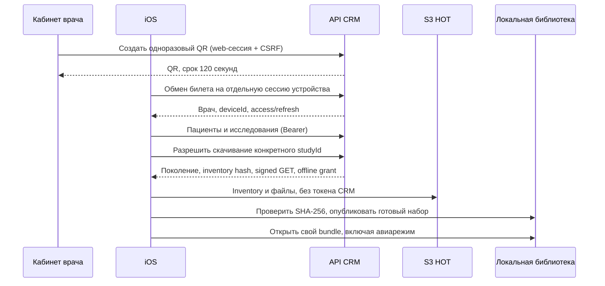

# Сопряжение приложения врача с CRM: контракт v1

Дата: 8 ноября 2026. Статус: **подготовлено к реализации, новые мобильные маршруты ещё не реализованы**. Этот документ не является отчётом о выкладке API. В рамках подготовки CRM, S3 и production не изменяются.

Область первого сопряжения: QR → сессия врача → его пациенты/исследования → настоящая загрузка сжатого набора → автономное открытие своим viewer. Запись пациентов, направления и чат подключаются следующими отдельными этапами по основному ТЗ. Проверена локальная копия `C:/Users/Matvey/Documents/Projects/orbital_doc_app/orbital_doc_app`, commit `7ce5d4d3344dd7dcb4bf1778837ffbbbfe8d0abc`, без незакоммиченных изменений. Она совпадает с предоставленным репозиторием `2967494-byte/orbital_doc_app`. Точные места доработки: [передача агенту iOS](doctor-mobile-ios-handoff-2026-11-08.md). Сборка и запуск Xcode на Windows не выполнялись.

Машиночитаемая спецификация: [OpenAPI](doctor-mobile-v1.openapi.json). [Описание примеров и тестовых наборов](doctor-mobile-v1-examples/README.md). Примеры и синтетические серии создаёт `.scripts/prepare-doctor-mobile-fixtures.py`; проверка — `.scripts/validate-doctor-mobile-contract.cjs`. Ни один новый пример не содержит действующих токенов, ключей S3 или данных пациентов.

## 1. Что уже есть и чего ещё нет

| Элемент | Подтверждено по коду | Применение в приложении |
| --- | --- | --- |
| Основной сервер | `https://admin.orbital3d.ru` | База API; не старый VPS `95.163.231.17` |
| `POST /api/viewer/launch/<appointment_id>` | Работает для web-сессии CRM | Не использовать как мобильный вход |
| `GET /api/viewer/resolve/<token>` | Проверяет `current_user`, ACL, опубликованное поколение; возвращает точные signed GET | Переиспользовать серверную логику проверки/подписи, не cookie-контракт |
| `GET /api/viewer/status/<appointment_id>` | Статус подготовки для авторизованного web-пользователя | Основа для мобильного DTO готовности |
| S3 HOT | `storage.yandexcloud.net`, `orbital3d-hot-storage`, `<appointment-root>/_viewer/...` | Файлы скачивает native по временным URL |
| Готовые сжатые DICOM | Служба формирует JPEG 2000 с целевым профилем 20×, manifest и HEX DICOM JSON с `_url` | Скачивать именно готовое опубликованное поколение |
| `/mobile/api/...` | Старое API менеджеров; resolver токенов перебирает роль `manager` | Не является входом врача; не расширять его детерминированные токены |
| `/api/native-upload/v1/...` | Другой продукт и направление передачи | Вообще не использовать для скачивания исследований врача |
| QR-привязка / сессии устройства врача | В проверенном коде отсутствуют | Реализовать новый namespace из этого контракта |
| Пер-файловые SHA-256 и размеры для мобильного скачивания | В текущем ready-manifest не найдены | Нужен дополнительный immutable inventory, см. §5 |

Проверенные исходники CRM: `app/blueprints/viewer.py`, `mobile_api.py`, `doctor.py`, `app/utils/viewer_compressor.py`, `access_manager.py`, `app/models/viewer_compression.py`, `medical.py`. Это инспекция локальных исходников; авторизованный прогон будущего мобильного API на production ещё невозможен. Фразы «будущий resolver» в документе от 4 ноября исторические: web-resolver уже реализован, отдельный мобильный — пока нет.

## 2. Архитектура

Весь кабинет обращается напрямую к API CRM по HTTPS. Большие файлы идут напрямую S3 → нативный downloader → защищённый диск. Движок viewer и декодеры поставляются внутри приложения; при офлайн-открытии CRM/VPS/S3 не вызываются. CRM не проксирует каждый срез, архивирование на лету не добавляем.

Native хранит авторизацию и выдаёт web-движку только ограниченный локальный `studyPrefix`/descriptor. В JS не передаются access/refresh, S3-подписи, общий доступ к Documents или произвольный адрес сервера. Локальный раздатчик доступен только приложению/loopback, не сети Wi-Fi.

## 3. Идентификаторы и общий формат

Namespace **для новой реализации**: `/api/doctor-mobile/v1`. JSON — camelCase; формат QR сохраняет ранее согласованные snake_case поля. Все ID в API — непрозрачные строки; не преобразовывать sourceVersion в число.

- `userId` — User, `doctorId` — карточка Doctor; это разные сущности.
- `patientId`, `appointmentId`, `studyId` — отдельные ID. Первый этап выдаёт основной `DicomStudy`; extras не маскировать под него.
- `sourceVersion`, `representationId`, `profileVersion`, `generationId`, `bundleId` — полная версия локального набора.
- `StudyInstanceUID`, `SeriesInstanceUID`, SOP UID — DICOM-идентификаторы. Не подменять ими ID CRM; не сопоставлять пациентов по ФИО.
- `serverId` — стабильный UUID установки CRM; `serverOrigin` — точный доверенный HTTPS origin.
- Времена — RFC3339 UTC; календарные даты исследования могут быть `YYYY-MM-DD`, timezone центра — отдельное поле.
- Ошибка: `{"error":{"code":"...","message":"...","retryable":false},"requestId":"..."}`. API не отвечает HTML login/redirect вместо JSON.
- `Authorization: Bearer <accessToken>` только для CRM. Не пересылать этот заголовок в S3 или на redirect к другому origin.

## 4. Вход и сессии

### QR

Сохранить формат из основного ТЗ: `type=orbital.doctor.pairing`, `version=1`, `server`, необязательный `doctor_id` как подсказка, `pairing_ticket`, `expires_at`. Постоянного пароля, S3-ключа или долгоживущего access token в QR нет.

`POST /pairings` вызывается только из авторизованного кабинета врача, с CSRF. Сервер сам определяет пользователя/Doctor. Пилот — подтверждённая, незаблокированная роль doctor с реальной карточкой Doctor. Для теста сотрудника создать отдельную тестовую учётку врача; не позволять суперадмину передавать произвольный doctorId из iPhone.

`POST /pairings/exchange`: `pairingTicket`, `clientRequestId` UUID, `deviceId` UUID из защищённого хранилища, `deviceName`, `platform=ios`, `appVersion`. В ответе — сессия устройства, подтверждённые данные врача, права, время сервера. Поля QR не являются доказательством личности.

Билет — случайный секрет, хранить его хеш; TTL 120 секунд, атомарный обмен, защита от подбора. Один билет создаёт максимум одну сессию. Потеря ответа на exchange: повтор того же `clientRequestId` и устройства может получить тот же результат из короткого защищённого replay-cache; другое устройство/другой requestId получает `pairing_used`. Не логировать билет или тело ответа.

Production доверяет только согласованному origin `https://admin.orbital3d.ru`. Другие установки добавляются в явный доверенный список; не принимать произвольные адреса/private IP/HTTP из QR. Отключение проверки TLS и скрытый demo-login запрещены.

### Сессия

- Новый случайный opaque access token и отдельный случайный refresh; в БД — хеши, пользователь, устройство, срок, отзыв, session_version.
- Предлагаемые пилотные сроки: access 15 минут; сессия refresh — 30 суток от привязки, без бесконечного продления. Это параметры backend, не константы клиента.
- `POST /sessions/refresh` ротирует refresh атомарно. Клиент делает refresh single-flight. Повтор с тем же `clientRequestId` после потери ответа идемпотентен короткое время; повтор старого refresh с другим requestId — сигнал повторного использования и отзыв соответствующей сессии.
- `DELETE /sessions/current`: выход и отзыв текущей сессии; отменить задачи скачивания. Управление/отзыв потерянных устройств добавить в кабинет врача в серверном этапе.
- `GET /me`: авторитетные User/Doctor/permissions. Блокировка, session_version и отзыв проверяются при каждом запросе, не только в момент выдачи токена.
- Access/refresh не хранятся в UserDefaults, файлах, логах или web-view. Выбрать Keychain accessibility с учётом foreground/background-сценария; привязочные секреты — вариант `ThisDeviceOnly`. Безопасность локальной копии не является DRM от владельца полностью скомпрометированного устройства.

### Важная серверная ловушка

Сейчас `can_access_appointment(appointment_id, user=...)` проверяет переданного user лишь предварительно, а затем вызывает `check_appointment_access(appointment_id)`, использующий `current_user`. Поэтому просто положить mobile user в `g` и вызвать старую обёртку **недостаточно**.

Выделить общую проверку `user + appointment` с явным principal, сохранив существующие правила own/shared/clinic и web-поведение. Из неё строить и фильтр списков, и проверку выдачи каждой загрузки/обновления URL. Нельзя выдавать полный список и фильтровать на iPhone. Переиспользовать `can_use_online_viewer(user)` с feature flag и `online_viewer_enabled`, не обходить его ролью/типом устройства.

## 5. Сжатый bundle и inventory

Существующий `_viewer/representations.json` выбирает поколение. `manifest.json` и HEX `ohif_metadata.json` уже существуют. Их пути/схемы менять ради iOS не требуется.

Добавить **immutable `download-inventory.json` для конкретного поколения**:

- binding: serverId/studyId/appointmentId/patientId, sourceVersion, representationId, profileVersion, generationId, bundleId; inventory общий для разрешённых врачей, userId/doctorId/deviceId в него не записывать — они привязываются отдельным grant;
- codec первого пилота — JPEG 2000 (`1.2.840.10008.1.2.4.91` для lossy). Не заявлять HTJ2K, пока мобильный декодер реально не проверен;
- серии: derived SeriesInstanceUID, путь индекса, instanceCount, frameCount; число файлов ≠ число кадров Enhanced CT;
- files: уникальные `fileId`, относительный путь от generation-root, `kind`, число байтов, SHA-256 точных сохранённых байтов, seriesId для индекса/инстансов;
- `totalBytes` — сумма files.bytes, `fileCount` — длина files. Сам inventory не перечисляет себя; его размер/хеш передаются в download grant.

В files входят неизменяемый manifest, индексы и все производные DICOM выбранного поколения. **Mutable representations.json в bundle не включать.** Не включать оригиналы, мусор Ez3D и файлы других поколений. Путь manifest `series.id/ohif_metadata.json` и `_url=instances/....dcm` остаются относительными и работают локально. Native local adapter выбирает одну seriesId из inventory: объединять разные SeriesInstanceUID в один volume нельзя. Текущий iOS-код такое объединение допускает — исправить до подключения настоящего каталога.

SHA-256 получать при подготовке файлов. ETag не считать SHA-256. Проверять уникальность путей/SOP, состав индексов и готовность полностью. Хеш inventory — SHA-256 его точного UTF-8 содержимого; получатель сначала проверяет сырые байты и только потом разбирает JSON, не сериализует его заново для сверки.

В БД добавить публикацию bundle, связанную с `ViewerCompressionJob`: job/source/profile/profileVersion/generation, bundleId, inventoryKey/bytes/hash, статус, counts, totalBytes, срок. Уникальность по полному поколению. Web-ready и mobile-download-ready различать: отсутствие inventory не должно ломать уже работающий web-viewer.

Для старых готовых поколений — отдельный backfill: один раз прочитать сжатые объекты, вычислить хеши/размеры, записать inventory и связать с точным job. **Не пересжимать**, не менять существующий ready-manifest и не делать сотни S3 GET/HEAD при каждом открытии карточки. Ошибка/удаление поколения → mobile not ready, без fallback на оригиналы. Для новых jobs inventory готовится из локальных файлов в том же рабочем процессе с соблюдением lease/owner/source-version проверок публикации.

## 6. Каталог и выдача загрузки

Операции и точные DTO — в OpenAPI. URL в этом разделе являются **проектом новых маршрутов**, а не адресами уже работающего API.

| Метод | Путь после namespace | Назначение |
| --- | --- | --- |
| GET | `/capabilities` | Версия контракта и включённые возможности, без PHI |
| POST | `/pairings` | QR из web-кабинета, web cookie + CSRF |
| POST | `/pairings/exchange` | Обмен одноразового QR |
| POST | `/sessions/refresh` | Ротация сессии |
| DELETE | `/sessions/current` | Выход |
| GET | `/me` | Врач и права |
| GET | `/patients` | Разрешённые пациенты, поиск, cursor/limit |
| GET | `/studies` | Разрешённые исследования, optional patientId, cursor/limit |
| GET | `/studies/{studyId}` | Карточка и готовность |
| POST | `/studies/{studyId}/downloads` | Зафиксировать поколение и разрешить загрузку |
| POST | `/downloads/{downloadId}/urls` | Обновить exact file URLs того же bundle |
| POST | `/studies/{studyId}/offline-access` | Продлить разрешение уже сохранённого bundle |

Состояния: `not_available`, `preparing`, `ready`, `expired`, `failed`, `forbidden`, `unsupported`. В карточке независимо `viewerStatus` и `downloadStatus`. `canDownload` true только при праве, доступе к study и готовой мобильной публикации. Списки используют агрегированные данные; точная проверка поколения и доступности выполняется при создании grant. Если инвентаризация ещё идёт, вернуть `409 download_not_ready` с retryAfterSeconds.

Создание download: `clientRequestId`, `expectedSourceVersion`, `expectedGenerationId`. Сервер сверяет ACL/право/текущий source/profileVersion/generation/live публикацию, фиксирует immutable bundle и выдаёт:

1. downloadId, срок сессии загрузки;
2. полную identity study и версии;
3. inventory URL/bytes/SHA-256;
4. точную карту `{fileId, downloadUrl}`;
5. urlsExpiresAt и **отдельное** подписанное offlineGrant.

URL — на точные объекты одного поколения, без ListObjects/wildcard и без общих S3-ключей. Стартовые TTL: signed GET 15 минут, download session до 1 часа; оба ограничены доступностью поколения. Размер приложения не прибавлять к объёму конкретного исследования.

Обновление URL: `clientRequestId`, bundleId, до 128 известных fileId. Клиент не присылает bucket/key/произвольный URL. Повторно проверяются сессия/ACL/блокировка/право. Ответ не меняет bundle, список файлов и хеш. Истёкшая S3-подпись сама по себе не означает отзыв врача. При смене актуального source или поколения незавершённую загрузку остановить с `409 source_changed`; начать новое поколение отдельно, не подмешивать файлы.

Запрос offline-access использует bundleId и inventorySha256: сервер знает, какой набор был выдан, проверяет право и возвращает новый grant. Не считать произвольный хеш от клиента доказательством доступа. Если прежнее поколение уже недоступно для продления, вернуть `410 bundle_expired`, а не выдавать разрешение на другой bundle. Уже сохранённую старую версию показывать с её настоящей версией/сроком; не переносить планы на новую геометрию автоматически.

## 7. Три срока и offline grant

Различать `urlsExpiresAt`, `hotExpiresAt`, `offlineAccessUntil`. Время хранения S3 не является таймером подписи URL. Истечение URL не блокирует допустимую готовую локальную копию.

**Предложение для пилота, требует продуктового подтверждения до включения production:** offline до 7 суток от выдачи, с верхней границей по текущему hotExpiresAt. При онлайн-работе обновлять разрешение заранее, без повторной передачи неизменившихся DICOM. Другой период или доступ к локальной копии после HOT-удаления — отдельная явная политика, не скрытый fallback.

Формат — JWS Compact, только ES256, отдельный серверный ключ, `kid`; алгоритм `none`, HMAC общим секретом приложения и неизвестный ключ запрещены. Для ES256 подпись в JWS — 64 байта `R || S`, не DER. Доверенные public keys поставлять через доверенную конфигурацию приложения/контролируемую ротацию, не брать ключ из QR, inventory или самого grant. Test key никогда не доверяется production.

Claims: iss=точный serverOrigin, aud=`orbital.doctor.ios.offline`, iat/nbf/exp (Unix seconds), jti, serverId, userId, doctorId, deviceId, patientId, appointmentId, studyId, sourceVersion, representationId, profileVersion, generationId, bundleId, inventorySha256, allowedActions=[`openLocalViewer`,`saveLocalProject`]. Срок в claims и offlineAccessUntil должны совпадать. Не помещать ФИО в grant.

Native проверяет подпись, audience/issuer/ключ, привязку к текущему врачу/устройству/серверу и точному bundle, состав/хеши и срок **до выдачи локального descriptor viewer**. Не использовать истёкший cloud manifest как обход или редактировать в нём expiresAt: native local mode читает локальные индексы после своей проверки offlineGrant, cloud loader сохраняет прежние проверки S3.

При сети применять подтверждённый отзыв/блокировку. Без сети мгновенный отзыв невозможен; предел задаёт offline grant. Сетевая ошибка не стирает локальные снимки. При подозрении на откат часов требовать проверку времени/доступа онлайн; абсолютная защита от управления устройством не обещается.

## 8. Исправления приложения, не зависящие от нового API

1. Убрать глобальный `realVatechStudyPrefix` из открытия пациентов. Он допустим только как явно выбранная demo-study в отдельной конфигурации.
2. Ввести `LocalStudyDescriptor` с полной identity из §3, локальным bundle path и путями индексов. Вызов viewer всегда получает descriptor **конкретного** исследования.
3. Существующий раздатчик `Documents/RealStudies` можно сохранить для переходного этапа, но добавить изоляцию: `<serverId>/<userId>/<studyId>/<bundleId>/bundle/...`. ФИО, URL и произвольный ключ S3 не являются именами каталогов. Финальное расположение приватной библиотеки согласовать с фактической iOS-реализацией; не открывать всю папку пациентов в Files/iCloud.
4. Рядом staging того же тома: `.partial/<downloadId>/`. Привязка background task → device session + studyId + bundleId + fileId сохраняется на диске. Позднее завершение старой задачи после выхода/смены врача не публикует набор.
5. Настоящие стадии: receiving inventory → downloading → verifying → ready. Прогресс — байты проверенных файлов + текущих `.part`, без повторного учёта байтов при retry. 100% передачи ещё не означает `ready`.
6. Начальная параллельность 4, предел 8; ограниченные повторы с backoff. При исчерпании места, обрыве сети и истечении ссылок сохранять проверенные файлы и понятный статус. Свободное место проверять по `totalBytes` плюс inventory/локальная мета/резерв; размер декодированного volume отдельно оценивать до открытия.
7. После загрузки сверить каждый размер/SHA-256, допустимые пути/дубликаты/число файлов и индексов, UID/геометрию, подпись разрешения. Затем атомарно переместить каталог и завершить локальную запись. После crash повторно согласовать файлы и БД; не доверять одному флагу ready.
8. Range/resume — только для того же fileId/хеша. Если сервер вернул 200 вместо 206, перезаписать `.part`, не дописывать целый файл к обрывку. После полной загрузки всё равно проверить SHA-256.
9. Запретить абсолютные пути, `..`, обратные слеши, URL/percent-encoded traversal, symlink escape; нормализованный путь остаётся внутри bundle. Signed URL не превращать в локальный путь.
10. Viewer/панорама читают эту локальную серию. Статичная ОПТГ или встроенная серия другого пациента не заменяют неудавшуюся загрузку. Сжатие 20× не уменьшает автоматически расход RAM после декодирования. Порядок срезов — проекция ImagePositionPatient на нормаль ImageOrientationPatient, а шаг Z — по позициям; InstanceNumber и SliceThickness не заменяют геометрию. Не подставлять 0.2 мм молча при её отсутствии. Первый пилот ограничить проверенным классическим CT; oblique/Enhanced CT/multiple-series разрешать по мере реализации и проверки, иначе явный `unsupported`, без неверных MPR/измерений.
11. Ключ локального рабочего проекта: serverId + userId + studyId + sourceVersion + generationId/bundleId + schemaVersion. Импланты/измерения одного пациента не переходят к другому.
12. Реальные исследования не встраивать в app bundle/репозиторий/TestFlight. Для встроенного demo использовать синтетические или проверенно обезличенные наборы.

## 9. Очерёдность работ и ручная приёмка

### A. Сейчас, без сервера

Привязать две разные локальные серии к двум test studyId, убрать общий prefix и фальшивое скачивание. Импорт готового `_viewer` из Files допускается как явно обозначенный demo import; распознавать поколение/индексы и связывать с выбранной test study, не со всеми пациентами. Выдача prod offlineGrant через импорт не обходится. Сборка: A и B показывают разные данные; выход/перезапуск/авиарежим это сохраняют.

### B. Backend: QR и каталог

Новый feature flag выключен по умолчанию. Модели pairings/device sessions, миграция, token auth и общий explicit-user ACL. Кабинет выдаёт QR и позволяет отозвать устройство. API me/patients/studies, реальные состояния без файловых URL. Проверка двумя врачами: own/shared/forbidden, одноразовый QR, expired/reuse, блокировка, revoke. Передать сборку iOS для входа и каталога.

### C. Backend: download bundle

Модель публикации inventory и backfill нескольких согласованных поколений. Endpoint downloads/urls/offline-access и серверный signing key. Приёмка: размер/хеш каждого объекта, retry/истечение ссылок, идентичный bundle после refresh, отсутствие исходников и смешивания поколений, ACL при каждом grant. Существующий browser viewer и compressor lease tests проходят.

### D. iOS: первая сквозная загрузка

Врач сканирует QR → видит только свои данные → скачивает одну **согласованную** серию → viewer открывает локальные файлы. Отдельно открыть второе исследование, переключаться A/B и проверить ФИО/серии/планы. Полностью завершить приложение, включить авиарежим, открыть обе локальные копии и сохранённый проект. Затем проверить разрыв/возврат сети, мало диска, отмену, фон/перезапуск и отзыв при следующем подключении.

Для первого демо не выбираем пациента из переписки автоматически. Начать с приложенных двух синтетических наборов. Первые клинические studyId выбирает владелец в своей CRM после проверки доступа тестового врача; при показе вне рабочего кабинета использовать обезличенную копию. Режим demo никогда не подменяет ошибку production API.

### E. Пилот

Согласовать срок офлайн-доступа, устройства/лимиты памяти, поведение при смене врача и удалении, затем включать ограниченному кругу. Полный кабинет подключать отдельными сборками; не считать этот read-only контракт реализацией записи/направлений/чата.

## 10. Ответ агенту iOS

Сервер известен: `https://admin.orbital3d.ru`. Целевой вход — QR → отдельная device session, не логин Uploader. Файлы — пофайловая загрузка готовой JPEG 2000 20× производной с manifest/индексами, дополненная проверяемым inventory и offline grant. Новые маршруты — в приложенном OpenAPI, **пока проект контракта**.

Уже сейчас делать локальную библиотеку/реальный прогресс/персональный descriptor/импорт A-B и панораму из своей серии. Не зашивать URL несуществующего backend как рабочий и не объявлять статус downloaded без файлов. Подключение сети начинается после серверных этапов B–C и явного подтверждения готовности endpoint-ов.

## 11. Проверка этой поставки

На 8 ноября 2026: 33 offline-проверки контракта и fixtures прошли; компилируются 25 DTO-схем, проверены подписи и негативные сценарии, оба набора приняты существующим compressed-study parser. Генератор прочитал/декодировал все 76 синтетических JPEG 2000 DICOM. Это проверка подготовленных материалов, не работающего native API и не сборки iOS. Изменений приложения, CRM, S3 и production в этой поставке нет; исходный код iOS только прочитан.

## Источники форматов

- [JWS — RFC 7515](https://www.rfc-editor.org/rfc/rfc7515), [ES256 — RFC 7518 §3.4](https://www.rfc-editor.org/rfc/rfc7518#section-3.4): формат подписи offline grant; остальная модель полномочий выше — наше проектное решение.
- [Apple: URLSessionDownloadTask](https://developer.apple.com/documentation/foundation/urlsessiondownloadtask): скачивание в файл; background-поведение и восстановление проверить на реальном iPhone.
- [Apple: Keychain ThisDeviceOnly](https://developer.apple.com/documentation/security/ksecattraccessiblewhenunlockedthisdeviceonly): пример accessibility для foreground-секретов; не переносить этот выбор автоматически на фоновый downloader.
